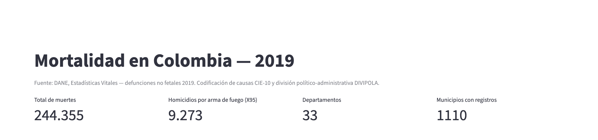
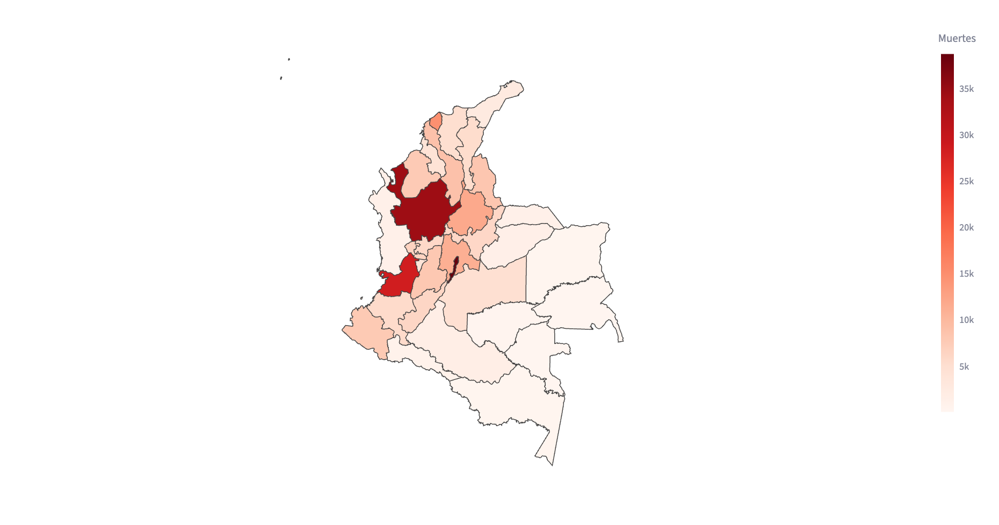
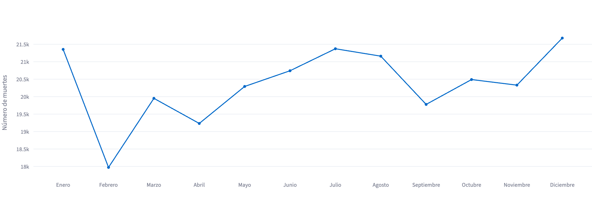
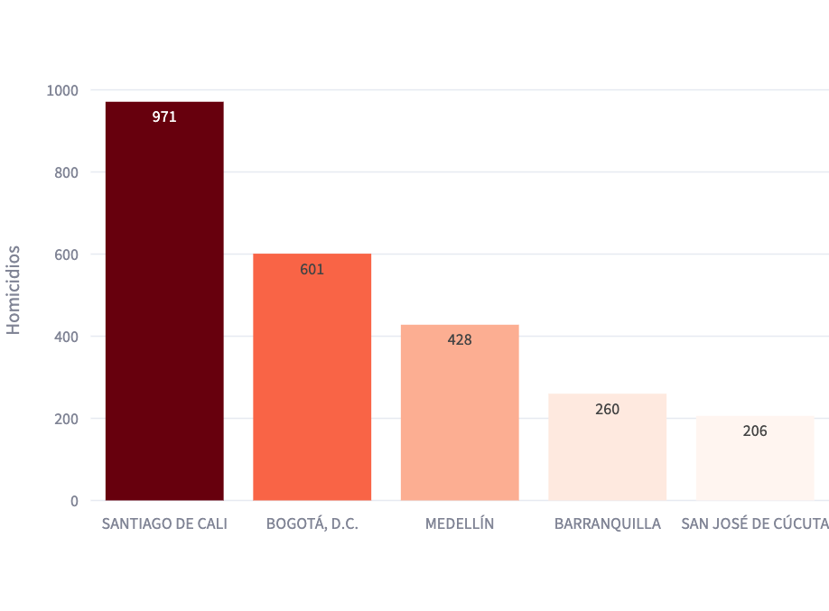
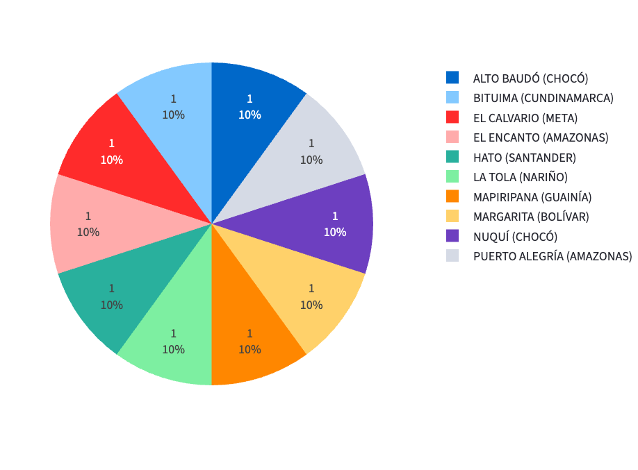
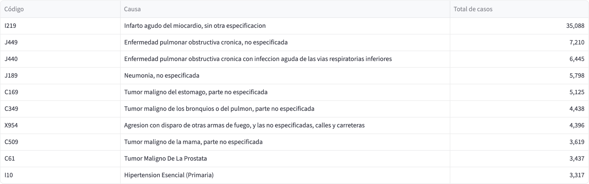
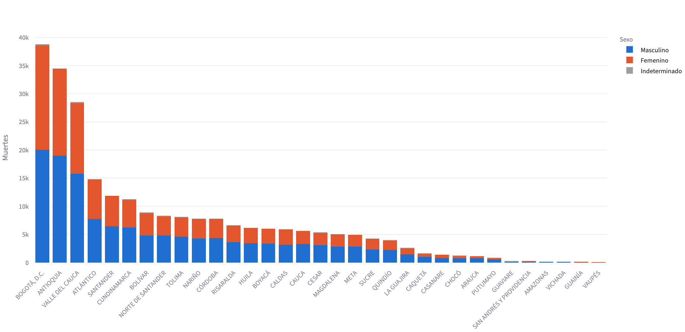
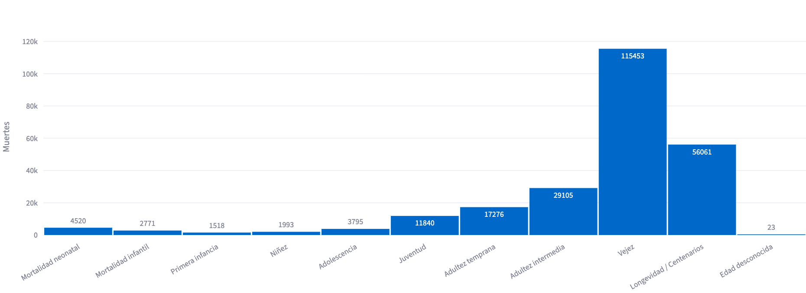

# Mortalidad en Colombia 2019

## Introducción

Aplicación web interactiva construida con **Python y Streamlit** para explorar las defunciones no fetales registradas en Colombia durante 2019, a partir de las Estadísticas Vitales publicadas por el DANE. La app une los microdatos de defunciones con el catálogo de causas CIE‑10 y la división político‑administrativa (DIVIPOLA) para mostrar los resultados en mapas, gráficos y tablas.

## Objetivo

Ofrecer una herramienta accesible para identificar **patrones demográficos y regionales de la mortalidad** en Colombia:

- Dónde se concentran las muertes (departamentos y municipios).
- Cómo varían a lo largo del año.
- Qué ciudades registran más homicidios por arma de fuego (CIE‑10 **X95**).
- Cuáles son las principales causas de muerte.
- Qué diferencias hay por sexo y en qué etapas del ciclo de vida ocurren más muertes.

## Estructura del proyecto

```
MortalidadEnColombia_web/
├── app.py                                   # Aplicación Streamlit (KPIs + 7 visualizaciones)
├── data_loader.py                           # Carga, limpieza, uniones y caché de datos
├── requirements.txt                         # Dependencias con versiones fijas
├── render.yaml                              # Configuración de despliegue en Render
├── .python-version                          # Versión de Python (3.13)
├── Anexo1.NoFetal2019_CE_15-03-23.xlsx      # Microdatos de defunciones no fetales 2019 (DANE)
├── Anexo2.CodigosDeMuerte_CE_15-03-23.xlsx  # Catálogo de causas de muerte CIE‑10
├── Divipola_CE_.xlsx                        # Códigos DIVIPOLA de departamentos y municipios
├── data/
│   ├── colombia_departamentos.geojson       # Polígonos de los departamentos para el mapa
│   ├── muertes.parquet                      # Caché de las columnas usadas de Anexo1
│   ├── codigos.parquet                      # Caché del catálogo CIE‑10
│   └── divipola.parquet                     # Caché de DIVIPOLA
└── docs/img/                                # Capturas de pantalla usadas en este README
```

**Procesamiento de datos (`data_loader.py`)**

- Lee los tres archivos de Excel la primera vez y guarda una copia en Parquet en `data/`; las siguientes ejecuciones cargan en segundos. Si se borran los `.parquet`, se regeneran solos.
- Une las defunciones con DIVIPOLA por `COD_DANE` (municipio) y `COD_DEPARTAMENTO`.
- Asigna el nombre de la causa buscando primero el código CIE‑10 de 4 caracteres y, si no existe, el de 3 caracteres (p. ej. `C61`, `I10`).
- `SEXO`: 1 = Masculino, 2 = Femenino, 3 = Indeterminado.
- `GRUPO_EDAD1` se agrupa en los rangos de la tabla de referencia:

| Categoría | Códigos DANE (GRUPO_EDAD1) | Rango de edad aproximado |
|---|---|---|
| Mortalidad neonatal | 0–4 | Menor de 1 mes |
| Mortalidad infantil | 5–6 | 1 a 11 meses |
| Primera infancia | 7–8 | 1 a 4 años |
| Niñez | 9–10 | 5 a 14 años |
| Adolescencia | 11 | 15 a 19 años |
| Juventud | 12–13 | 20 a 29 años |
| Adultez temprana | 14–16 | 30 a 44 años |
| Adultez intermedia | 17–19 | 45 a 59 años |
| Vejez | 20–24 | 60 a 84 años |
| Longevidad / Centenarios | 25–28 | 85 a 100+ años |
| Edad desconocida | 29 | Sin información |

## Requisitos

- Python **3.13** (3.12 también funciona)
- Librerías (`requirements.txt`):

| Librería | Versión | Uso |
|---|---|---|
| streamlit | 1.66.1 | Interfaz web |
| pandas | 3.1.0 | Manipulación de datos |
| openpyxl | 3.1.5 | Lectura de los archivos `.xlsx` |
| plotly | 7.1.0 | Gráficos interactivos y mapa |
| pyarrow | 26.0.0 | Caché en formato Parquet |

## Software

- **Python 3.13** — lenguaje principal.
- **Streamlit** — framework para la aplicación web.
- **Pandas** — limpieza, uniones y agregaciones.
- **Plotly Express** — mapa coroplético, líneas, barras, barras apiladas y gráfico circular.
- **Render** — plataforma de despliegue.
- **Git / GitHub** — control de versiones.
- **Visual Studio Code** — editor.

## Instalación

```bash
# 1. Clonar el repositorio
git clone https://github.com/<usuario>/MortalidadEnColombia_web.git
cd MortalidadEnColombia_web

# 2. Crear y activar un entorno virtual
python3.13 -m venv .venv
source .venv/bin/activate        # Windows: .venv\Scripts\activate

# 3. Instalar dependencias
pip install -r requirements.txt

# 4. Ejecutar la aplicación
streamlit run app.py
```

La app se abre en <http://localhost:8501>.

## Despliegue en Render

1. Subir el proyecto a un repositorio de GitHub. Se incluyen los archivos de `data/` (`.parquet` y `.geojson`) para que el servidor no tenga que procesar los Excel en el primer arranque.
2. En [render.com](https://render.com) crear un **New → Web Service** y conectar el repositorio. Render detecta `render.yaml`; si se configura a mano, usar:
   - **Runtime:** Python 3
   - **Build Command:** `pip install -r requirements.txt`
   - **Start Command:** `streamlit run app.py --server.port $PORT --server.address 0.0.0.0 --server.headless true`
   - **Variable de entorno:** `PYTHON_VERSION = 3.13.0`
3. Elegir el plan (el gratuito es suficiente) y pulsar **Create Web Service**.
4. Cuando el build termine, Render publica la URL pública `https://<nombre-servicio>.onrender.com`.

> En el plan gratuito el servicio se suspende tras un periodo de inactividad; la primera visita posterior tarda unos segundos en despertar.

## Visualizaciones y resultados

### Indicadores generales



En 2019 se registraron **244.355 muertes no fetales** en 33 departamentos (incluido Bogotá D.C.) y 1.110 municipios. **9.273** corresponden a homicidios por disparo de arma de fuego (X95).

### 1. Mapa: muertes por departamento



Mapa coroplético; el color más intenso indica más muertes y, al pasar el cursor, se ve el valor exacto. La mortalidad se concentra en los territorios más poblados: **Bogotá D.C. (38.760)**, **Antioquia (34.473)** y **Valle del Cauca (28.443)**, seguidos de Atlántico (14.804) y Santander (11.894). Los departamentos de la Amazonía y la Orinoquía registran los valores más bajos (Vichada 188, Guainía 115, Vaupés 87). Son cifras absolutas, así que reflejan sobre todo el tamaño de la población.

### 2. Gráfico de líneas: muertes por mes



La mortalidad se mantiene estable a lo largo del año, entre unas 18.000 y 21.700 muertes mensuales. **Diciembre (21.678)**, julio (21.372) y enero (21.354) son los meses más altos; **febrero (17.974)** es el más bajo, en parte por tener menos días.

### 3. Gráfico de barras: las 5 ciudades más violentas



Homicidios con código **X95** (agresión con disparo de otras armas de fuego y las no especificadas). **Santiago de Cali (971)** encabeza la lista con un número muy superior al de **Bogotá (601)**, a pesar de tener cerca de un tercio de su población. Le siguen **Medellín (428)**, **Barranquilla (260)** y **Cúcuta (206)**.

### 4. Gráfico circular: las 10 ciudades con menor mortalidad



Municipios con menos muertes registradas. Varios municipios tienen **1 sola muerte** en 2019, así que el gráfico reparte el 10 % a cada uno; los empates se ordenan alfabéticamente. Son municipios pequeños o apartados (Alto Baudó y Nuquí en Chocó, El Encanto y Puerto Alegría en Amazonas, Mapiripana en Guainía, entre otros). Al no contar con datos de población, no es posible calcular una tasa por habitante.

### 5. Tabla: las 10 principales causas de muerte



El **infarto agudo del miocardio (I219)** es por mucho la primera causa, con **35.088** casos, casi cinco veces más que la segunda. Le siguen la EPOC (J449 y J440), la neumonía (J189) y varios tumores malignos (estómago, pulmón, mama y próstata). La única causa externa en el top 10 es **X954**, homicidio por arma de fuego en calles y carreteras (4.396 casos).

### 6. Gráfico de barras apiladas: muertes por sexo en cada departamento



A nivel nacional mueren más hombres (**134.573**, 55 %) que mujeres (**109.689**, 45 %); 93 registros tienen sexo indeterminado. La brecha es menor en Bogotá (52 % hombres) y Atlántico (53 %), y mucho mayor en departamentos como **Guaviare (77 %)** y **Guainía (68 %)**, donde pesan más las causas violentas y accidentales.

### 7. Histograma: muertes por grupo de edad



La mortalidad se concentra en la **vejez (60–84 años): 115.453 muertes (47 %)**, seguida de longevidad/centenarios (85+, 56.061) y adultez intermedia (45–59 años, 29.105). Entre los menores de 1 año, la **mortalidad neonatal (4.520)** supera a la infantil (2.771). A partir de la juventud (20–29 años, 11.840) las muertes aumentan de forma notable frente a la adolescencia.
